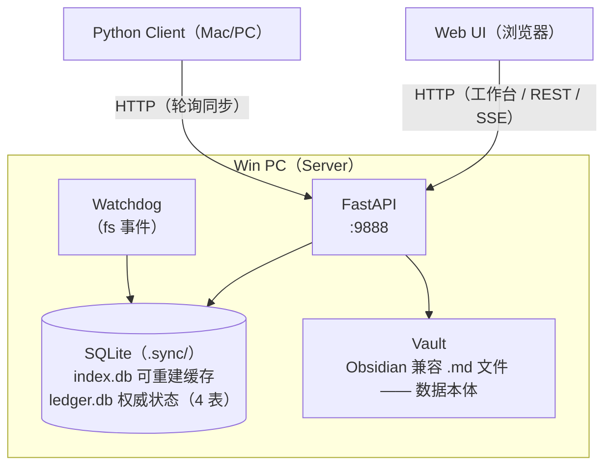

# md-sync

LAN 多设备 Markdown 文档同步系统。Win PC 跑 FastAPI 服务端，Mac/手机通过 Python 客户端或 Web 工作台访问。vault 目录既是数据本体，也是可直接打开的 Obsidian vault——`.sync/` 目录下的两个 SQLite 文件承载索引与权威状态，用户内容始终是纯 `.md` 文件。

## 功能

- **文件同步** — SHA-256 哈希比对，冲突自动保留双方版本（`.conflict-{device}.md`）
- **Web 工作台** — Vue 3 CDN SPA，文件树浏览、Markdown 编辑/预览（marked.js + DOMPurify + highlight.js + mermaid）、AI 助手、记忆控制台、后台监控页
- **FTS5 检索** — SQLite FTS5 + jieba 中文分词，BM25 排序，四档召回（strict/near/relaxed/fuzzy），增量索引
- **知识图谱** — wikilink/tag/related 关系抽取，关联文档发现（N-hop）
- **变更账本（双账本）** — `.sync/` 下两个 SQLite：`index.db` 可重建缓存（files/segments/edges/change_log/trigger_state/recall_log/sessions/notifications 等），`ledger.db` 权威状态（proposals/proposal_transitions/snapshots/relatedness，无重建来源）。变更由 `server/ledger.py` 统一归因记账
- **AI Agent** — 基于 OpenAI 兼容 API 的 15 个工具调用 agent，可读写/搜索/移动/删除文档、创建并评审提案，写操作需用户确认
- **提案通道** — bgagent/agent 产出提案 → 状态机（8 状态）→ 双通道（Web 控制台 / agent 工具）同一 decide 路径 → executor 落地 → 回读反馈；DB 为唯一状态源，零文件落
- **后台 agent（五角色）** — 碎片整理（事件驱动）· 矛盾批注（低频巡查：cron + change 源 arming）· 执行器（确定性、无 LLM、adopted 提案唯一落地者）· 召回诊断 · 历史回顾（生产禁用）
- **MCP Server** — 独立 stdio 进程，给 AI 助手（OpenCode 等）提供 6 个工具（读取走 `read_doc`/`search_docs`/`get_related_docs`，写入仅 `propose` 提案通道）

## 架构



- **服务端**：FastAPI 应用，`/` 提供 Web 工作台，`/api/*` 暴露 REST + SSE，watchdog 监听 vault 文件事件驱动变更账本记账。
- **Web UI**：浏览器直接访问工作台，文件树/编辑器/AI 助手/记忆控制台/监控页。
- **Python Client**：轮询 `/api/sync`，增量拉取/推送，处理冲突。

## 快速开始

### 1. 安装

```bash
pip install -e ".[dev]"
```

### 2. 配置

复制 `config.example.yaml` 为 `config.yaml`，修改。服务端与客户端读同一份文件，各自只读自己那节（`server:` / `client:`），可选 `ai:`、`background_agents:`、`notifications:`。

```yaml
# 服务端配置 (Win PC)
server:
  host: 0.0.0.0
  port: 9888
  vault_dir: ./vault
  log_level: INFO  # 可选: DEBUG / INFO / WARNING / ERROR / CRITICAL

# 客户端配置 (Mac)
client:
  server_url: http://192.168.1.100:9888
  vault_dir: ./vault
  device_name: mac
  poll_interval: 300

# AI 配置 (可选) — 支持 tool calling（agent 工具调用）
ai:
  base_url: "https://api.deepseek.com/v1"  # or http://localhost:11434/v1 for Ollama
  api_key: "your-api-key"
  model: "deepseek-chat"
  max_tokens: 4096
  context_window: 131072
  temperature: 0.7
  # tools: [read_doc, search_docs, propose]  # 可选：工具白名单；缺省 = 全部工具
```

### 3. 启动服务端

```bash
python -m server.main config.yaml
# → http://localhost:9888
```

首次启动自动扫描 vault 中的 `.md` 文件建立索引（`ensure_indexed` 两级自检：首跑全量重建 segments+图谱 / FTS 失步时仅从内容表修复）。

### 4. 启动客户端（可选）

```bash
python -m client.main config.yaml
# → 每 poll_interval 秒轮询同步
```

### 5. 打开 Web 工作台

浏览器访问 `http://<server-ip>:9888`，即可使用文件树、编辑器、AI 助手、记忆控制台。

## Web 工作台

Vue 3 CDN SPA，无构建步骤：`server/templates/index.html`（壳）+ `server/templates/js/`（`app.js` 主入口、`api.js`、`components/`、`utils/`）+ `style.css`，`/static` 挂载自 templates 目录。渲染栈：marked.js + DOMPurify + highlight.js + mermaid + Tailwind CSS CDN + Flowbite 2.5.2。

| 组件 | 说明 |
|------|------|
| 文件树（FileTree） | 递归目录结构，搜索过滤，选中展开 + 高亮滚动；桌面 260px 面板，移动端左侧滑入 overlay |
| 搜索（SearchPanel） | FTS5 全文检索，四档召回（strict/near/relaxed/fuzzy）；结果跳转文档并滚动到标题 |
| 编辑/预览（EditorPane） | 分段切换，默认预览；page-turn 翻页动画，代码高亮 + mermaid 图表 |
| AI 助手（AIChatPanel） | 右侧滑出面板，SSE 流式响应，工具调用卡片，写操作确认按钮；移动端底部抽屉（MobileSheet） |
| 记忆控制台（MemoryConsole） | 提案审查队列 + 报告渠道 + 状态脉搏（30s 轮询）；桌面 300px in-flow，移动端全宽 overlay |
| 后台监控页（MonitorPage） | 独立监控页（非对称网格），提案/触发器/召回/执行器/快照一屏总览 |
| 顶栏（TopBar） | 模式切换、保存、下载、通知铃铛下拉 |
| 冲突横幅（ConflictBanner） | agent 改动了正在编辑的文档时的确认条 |

轮询：变更 10s（`pollChanges`）、通知 30s（`pollNotifications`）、记忆控制台 30s（`pollMemory`）。

## AI Agent 工具

15 个工具，一模块一工具（`server/agent/tools/`）。**需确认**（`permission = "ask"`）的 6 个写/决策工具在执行前会先发确认请求，等人批准；其余 9 个自动执行。

| 工具 | 权限 | 说明 |
|------|------|------|
| `read_doc` | 自动 | 读取文档内容 |
| `search_docs` | 自动 | FTS5 + jieba 中文搜索（四档召回） |
| `list_files` | 自动 | 列出 vault 文件 |
| `write_doc` | **需确认** | 创建/覆盖文档 |
| `delete_doc` | **需确认** | 删除文档 |
| `move_docs` | **需确认** | 移动/重命名文档（批量） |
| `edit_doc` | **需确认** | 精确文本替换 |
| `get_related_docs` | 自动 | 图谱关联文档（wikilink/tag/related，N-hop） |
| `recent_changes` | 自动 | 变更日志查询（谁改了什么，按 source 过滤） |
| `recall_stats` | 自动 | 召回遥测统计（sentinel 治理用） |
| `propose` | 自动 | 创建提案（只写 DB 记录，零文件落；actor 为可信戳） |
| `list_proposals` | 自动 | 列出提案（只读，按状态/类型过滤） |
| `get_proposal` | 自动 | 读取单条提案详情（审阅摘要） |
| `adopt_proposal` | **需确认** | 采纳提案（与 Web 控制台共享同一 advance 决策路径） |
| `reject_proposal` | **需确认** | 拒绝提案（与 Web 控制台共享同一 advance 决策路径） |

安全边界：路径不能越出 vault、仅限 `.md` 文件、`.sync/` 目录受保护。

## 提案通道

bgagent 与 agent 通过 `propose` 工具产出提案（5 类动词：entity_index / relatedness / summary / errata / reminder），提案进入 8 状态机流转，由 Web 记忆控制台或 agent 工具走**同一** `proposals.advance` 决策路径（DB 为唯一状态源，`suggestions/` 零文件落）。adopted 提案由确定性 executor 落地，落地后回读反馈。回滚、rebase 等可逆操作是 human-only 动词。

状态机与权限细节见深度文档：`~/md-vault/projects/md-repo/specs/2026-10-21-memory-runtime-design.md`。

## API 端点

按 6 域分组（路由顺序由 `tests/test_routes_order.py` 钉住，每域模块经 `register(app, ctx)` 注册到 `WebContext`）。

### console（前缀 `/`、`/api/docs`、`/api/graph`）

| 方法 | 路径 | 说明 |
|------|------|------|
| GET | `/` | Web 工作台 HTML（index.html 壳） |
| GET | `/api/health` | 健康检查（status + file_count） |
| GET | `/api/docs` | 文件列表（files + dirs，隐藏系统目录，ETag 304） |
| GET | `/api/docs/changes?since=<ts>` | 增量变更日志 |
| GET | `/api/graph/backlinks?path=<p>` | 反向链接（谁引用了这篇） |
| GET | `/api/graph/related?path=<p>&hops=1` | 关联文档（N-hop） |
| GET | `/api/docs/{path}` | 读取文档内容 |
| POST | `/api/docs/manage` | 文档管理（create_file / create_folder / rename / move / delete） |
| POST | `/api/docs/{path}` | 上传文档（multipart） |
| PUT | `/api/docs/{path}` | 保存文档 |

### notifications（`/api/notifications`）

| 方法 | 路径 | 说明 |
|------|------|------|
| GET | `/api/notifications?unread=<n>` | 通知列表（最近 50 条） |
| POST | `/api/notifications/read` | 标记已读（`all` 或 `ids`） |

### sync（`/api/sync`）

| 方法 | 路径 | 说明 |
|------|------|------|
| POST | `/api/sync` | 客户端同步（compare_files → to_pull / to_push / conflicts / to_delete / notifications） |

### recall（`/api/ai`、`/api/recall`）

| 方法 | 路径 | 说明 |
|------|------|------|
| POST | `/api/ai/search` | FTS5 搜索（四档召回）+ 召回遥测落账 |
| GET | `/api/recall?since=<ts>` | 召回遥测日志（最近 500 条） |
| GET | `/api/recall/stats` | 召回调维（per-doc 流量 + 衰减权重 + 零命中账本） |

### memory（`/api/memory`）

| 方法 | 路径 | 说明 |
|------|------|------|
| GET | `/api/memory/proposals` | 列出所有提案记录（含 trail 摘要） |
| POST | `/api/memory/proposals/{relpath}/adopt` | 采纳提案（awaiting_review → adopted，actor human） |
| POST | `/api/memory/proposals/{relpath}/revive` | 复活过期提案（expired → awaiting_review，human-only） |
| POST | `/api/memory/proposals/{relpath}/reject` | 拒绝提案（awaiting_review → rejected，reason 必填） |
| GET | `/api/memory/proposals/{relpath}/trail` | 提案轨迹（newest first，max 12 行） |
| GET | `/api/memory/proposals/{relpath}` | 提案详情（record 字段） |
| POST | `/api/memory/rollback` | 回滚一个 tool call（human-only） |
| GET | `/api/memory/rollback-calls` | 近期 call 组（human 回滚入口） |
| GET | `/api/memory/reports` | 报告渠道列表（`index/reports/**`） |
| GET | `/api/memory/reports/{relpath}` | 读取单个报告 markdown |
| GET | `/api/memory/status` | 状态脉搏（proposals / agents / recall / executor / snapshot） |

### agent（`/api/ai`、`/api/agent`）

| 方法 | 路径 | 说明 |
|------|------|------|
| POST | `/api/ai/chat` | 简单 AI 对话（SSE 流式，current_doc / rag_search 上下文） |
| POST | `/api/agent/chat` | Agent 工具调用对话（SSE 流式，含确认） |
| POST | `/api/agent/confirm` | 确认/拒绝待审批工具调用 |
| POST | `/api/agent/new-session` | 新建会话（返回 session_id） |

## MCP Server（接入 OpenCode 等 AI 助手）

MCP server 是独立的 stdio 进程（`server/mcp_server.py`，`md-vault-mcp` 命令），给 AI 助手提供 6 个工具：读取走 `read_doc`/`search_docs`/`get_related_docs`，写入仅 `propose` 提案通道（与 agent 相同的 record 管道，actor 为 `mcp`，不落文件）。外部 agent 的主记忆区只读——`write_doc`/`edit_doc` 直写被双重 gate 拒绝。启动时共用 `ensure_indexed` 建立索引。

### 1. 安装

```bash
pip install -e ".[mcp]"        # 生成 md-vault-mcp 命令
which md-vault-mcp             # 确认在 PATH 中（如 .venv/bin/md-vault-mcp）
```

### 2. 注册到 OpenCode

编辑 `~/.config/opencode/opencode.json`，在 `mcp` 段追加：

```json
{
  "mcp": {
    "md-vault": {
      "type": "local",
      "command": ["md-vault-mcp"],
      "enabled": true
    }
  }
}
```

> 若 `md-vault-mcp` 不在系统 PATH（如装在 venv 里），把 `command` 改成绝对路径：
> `["/path/to/.venv/bin/md-vault-mcp"]`。

### 3. 追加 AGENTS.md 提示词

在项目 `AGENTS.md`（或 `~/.config/opencode/AGENTS.md`）加入，让 agent 优先查 vault 而非 web 搜索：

````markdown
## MD Vault

A personal knowledge base synced across devices. Use the `md-vault` MCP tools
BEFORE web search or memory recall when you need project context, prior
decisions, or development notes:

- **search_docs**: Find relevant documents by keyword (FTS5 + Chinese support)
- **get_related_docs**: Discover related documents via wikilinks/tags
- **read_doc**: Read full document content
- **propose**: Create a proposal record — the only write path into the proposal channel

The main memory area is read-only for external agents — `propose` is the only
write; direct writes (`write_doc` / `edit_doc`) are rejected by the server.

If the MCP server is not available, skip vault access — do not fall back to
reading vault files directly.

### MCP Server Restart

The `md-vault` MCP server is a long-running stdio process launched by OpenCode
(`command: ["md-vault-mcp"]` in `~/.config/opencode/opencode.json`). Code changes
to `server/mcp_server.py` do NOT take effect until the process is restarted.
To restart:

1. Run `/mcp` in OpenCode to see the server list and reconnect, OR
2. Restart the OpenCode session entirely.

After a restart, verify reads with a quick `search_docs` + `read_doc` round-trip;
for writes use `propose` (the main memory area is read-only for external agents).
````

### 4. 重启生效

MCP server 是 OpenCode 启动时拉起的长驻进程，改完配置或代码后需重启：OpenCode 里跑 `/mcp` 重连，或整个会话重启。验证：读取用一次 `search_docs` + `read_doc` 往返；写入用一次 `propose` 建测试记录再 `get_proposal` 读回（外部 agent 主记忆区只读，写入仅走 `propose` 提案通道）。

## 项目结构

```
├── server/
│   ├── main.py               # 入口：config → 双账本(index.db+ledger.db) → app → build_runtime() → uvicorn
│   ├── api.py                # create_app 工厂（WebContext + /static 挂载 + routes 注册）
│   ├── ledger.py             # 变更账本（change_log+files 唯一写入面：register/record/record_folder/consume）
│   ├── events.py             # 进程内事件总线（change / recall 等）
│   ├── sync.py               # compare_files（无 IO 纯函数，manifest 对比）
│   ├── snapshot_watcher.py   # SnapshotWatcher：doorbell + 脏集合 + 快照对比
│   ├── snapshots.py          # 快照（可逆层：删除/写前全文快照，回滚入口）
│   ├── proposals.py          # 提案状态机（8 状态，DB 为状态源，零文件落）
│   ├── recovery.py           # 恢复演练：证明 index.db 是可重建缓存（只动 index.db）
│   ├── sync_lock.py          # 内存同步锁（try_acquire，300s 自愈）
│   ├── logrotate.py          # 服务端日志定期清理（.sync/logs，保留 N 天）
│   ├── model.py              # ModelConfig（bgagent base-layer 模型配置）
│   ├── ai.py                 # RAG 搜索（rag_search）+ LLM 流式（chat_stream）
│   ├── mcp_server.py         # MCP stdio server（6 工具，接入 OpenCode 等）
│   ├── config/               # YAML 配置解析包（core/ai/log/notifications/bgagent）
│   ├── vault/                # 索引子系统：db/（SQLite+FTS5+图谱+账本表）· fs/（切块+链接解析+vault_ops）· orchestration/（indexer+refs+移动检测+file_ops）
│   ├── agent/                # LLM agent：tools/（15 工具，一模块一工具）· runtime · session · policy · prompts · reminders
│   ├── bgagent/              # 后台 agent：scheduler（cron+事件arming）· runner · notify · executor（确定性框架角色）
│   ├── routes/               # 路由 6 域（console/notifications/sync/recall/memory/agent），每域 register(app, ctx)
│   ├── prompts/              # bgagent 角色提示词（碎片整理/矛盾批注/执行器/召回诊断/历史回顾 + agent system prompt）
│   └── templates/            # Web UI 静态资源：index.html（壳）+ js/（app/api/components/utils）+ style.css
├── client/
│   ├── main.py               # 轮询循环入口
│   ├── config.py             # ClientConfig（server_url/vault_dir/device_name/poll_interval）
│   ├── state.py              # .sync/state.json（last_sync + files hash 表）
│   └── sync.py               # scan_local_files → POST /api/sync → to_pull/to_push/conflicts/to_delete
├── tests/                    # pytest 套件
└── docs/                     # 实施计划（superpowers/plans）+ 提案通道 HTML 总览
```

## 测试

```bash
pytest tests/ -v          # 跑全部测试
```

## 待办

- [ ] 拆分 server / client 为独立发布的包（当前 `pip install md-sync` 一并安装两者，client 用户被迫带上 fastapi/openai 等 server 依赖）

## 设计约束

- **无认证、无 HTTPS** — LAN 专用，不暴露公网
- **仅同步 `.md` 文件** — 不做版本历史
- **删除不同步** — 客户端删除的文件服务端保留，下次同步重新拉取
- **冲突策略** — 双方都修改时生成 `.conflict-{device}.md`，本地版本不动

## 技术栈

Python 3.10+ · FastAPI · uvicorn · SQLite (FTS5) · jieba · watchdog · httpx · openai SDK · Vue 3 · Tailwind CSS · Flowbite · marked.js · DOMPurify · highlight.js · mermaid

## 深度设计文档

架构变更前建议先检索（md-vault MCP）并读全文：

- 总设计：`~/md-vault/projects/md-repo/specs/2026-09-27-md-sync-design.md`
- 双账本拆分：`~/md-vault/projects/md-repo/specs/2026-10-31-ledger-file-split-design.md`
- 提案通道状态机：`~/md-vault/projects/md-repo/specs/2026-10-21-memory-runtime-design.md`
- 前端重构（Vue 3 CDN）：`~/md-vault/projects/md-repo/specs/2026-10-08-vue3-cdn-frontend-refactor-design.md`
- MCP Server：`~/md-vault/projects/md-repo/specs/2026-10-02-mcp-server-design.md`
