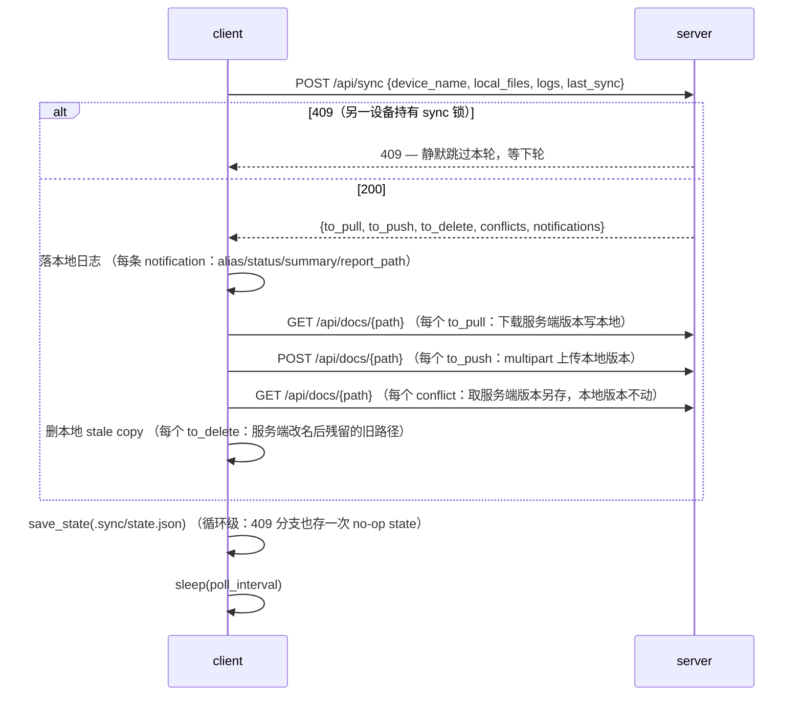

# client — 轮询同步客户端

md-sync 的客户端：本地 Obsidian vault 的同步端。轮询服务端，每轮全量上报本地 Markdown 文件清单，按服务端比对结果执行 **pull / push / delete / 冲突隔离**，并把服务端回包里的 background-agent 通知落到本地日志。无 Web、无 agent，纯同步 + 通知落地。

入口：`python -m client.main config.yaml`（缺省读 `config.yaml`；启动后进入无限轮询循环）。

## 模块结构

| 文件 | 职责 |
|------|------|
| `main.py` | 入口：`load_client_config` → 建 `<vault>/.sync/` → `run_polling_loop`；捕获 `KeyboardInterrupt` 干净退出 |
| `config.py` | `ClientConfig` 数据类 + `load_client_config`：读单一 `config.yaml`，只取 `client:` 段 |
| `sync.py` | 核心：`scan_local_files` / `sync_once` / `run_polling_loop`（含同步协议执行 + 日志设置） |
| `state.py` | 本地同步状态持久化：`load_state` / `save_state`（`<vault>/.sync/state.json`） |
| `__init__.py` | 空（包标记） |

## 公共 API

### config.py

```python
@dataclass
class ClientConfig:
    server_url: str      # 服务端 base URL（load 时 rstrip("/") 去尾斜杠）
    vault_dir: Path      # 本地 vault 绝对路径（相对路径相对 config 文件所在目录解析）
    device_name: str     # 设备名（冲突文件命名 {stem}.conflict-{device_name}{suffix} 用）
    poll_interval: int   # 轮询间隔秒（config 缺省 300）

def load_client_config(config_path: str) -> ClientConfig
```

### state.py

```python
def load_state(state_path: Path) -> dict
# 返回 {"last_sync": <iso>, "files": {relpath: sha256}}；文件缺失 / 坏 JSON / 非 dict → {}

def save_state(state_path: Path, state: dict) -> None
# 建父目录，JSON 写（ensure_ascii=False, indent=2）
```

### sync.py

```python
def scan_local_files(vault_dir: Path) -> dict[str, str]
# 遍历 vault_dir 下所有 *.md，排除 .sync/ 路径；返回 {相对路径(forward slash): sha256}

def sync_once(config: ClientConfig, state: dict) -> dict
# 一轮同步。返回更新后的 state dict。
# 服务端 409（另一设备持有 sync 锁）→ 原样返回 state，静默等下轮。
# 网络错误 → 抛给调用方（由 run_polling_loop 兜底）。

def run_polling_loop(config: ClientConfig) -> None
# 无限循环：load_state → sync_once → save_state → sleep(poll_interval)。
# 捕获除 KeyboardInterrupt 外的一切异常，记 warning 后继续下一轮 —— 永不因错误崩溃。
# 启动时 _setup_logging 把 root logger 接到 .sync/logs/sync.log（文件 + stdout）。
```

## 关键设计 / 同步链路

一轮同步（`sync_once`）的协议流程：



**不变量：**

- **服务端权威比对在服务端**：服务端拿 `local_files`（客户端全量 hash 上报）对 `index.db` files 表（`get_all_files`）做 hash 比对，产出四种差异列表。客户端每轮**全量**上报 `local_files`，不依赖 `state.json` 做增量比对：`state.json` 持久化 `last_sync`（下轮上报的 rename 检测 + 通知窗口起点）+ 本地 `files` hash 快照（仅供本地留存，不参与比对）——每轮 fresh 扫描 `local_files` 全量上报，比对与增量决策全在服务端。协议出处见 `~/md-vault/projects/md-repo/specs/2026-09-27-md-sync-design.md`。
- **`last_sync` 双用途（服务端）**：① rename 检测窗口 —— 取 `last_sync` 之后的 `moved` 事件（`recent_moves`），把改名前残留的旧路径移入 `to_delete`，防止客户端把 stale 旧路径 push 回去重新建出来；② 通知回包窗口 —— `notifications` 表里 `read=0 AND ts > last_sync`（cap 50）。change_log 服务端侧见 `~/md-vault/projects/md-repo/specs/2026-10-01-file-change-log-design.md`。
- **409 静默**：服务端 `sync_lock` 同一时刻只放一台设备同步；拿不到锁返回 409，客户端本轮什么都不做、等下轮。sync 锁 stale 300s 自愈（崩溃的 sync 不卡死服务端）。
- **永不崩溃**：`run_polling_loop` 捕获所有非 `KeyboardInterrupt` 异常，记日志继续 —— 网络抖动、服务端临时不可用都不终止循环。

## 依赖方向

```
main.py  ──►  config.py (load_client_config)
        └──►  sync.py   (run_polling_loop)
sync.py  ──►  config.py (ClientConfig)
        └──►  state.py  (load_state / save_state)
state.py / config.py  ──►  仅 stdlib（config.py 另 import yaml）
```

- **client 包零 server 依赖**：纯 HTTP 客户端，只通过 `httpx` 与服务端 `/api/sync`、`/api/docs/{path}` 交互，不 import `server` 任何模块。
- 外部依赖：`httpx`（HTTP）、`yaml`（config 解析）。

## 注意事项

- **「删除不同步」是设计**（AGENTS.md 口径）：客户端删掉一个文件，只是下次 sync 不上报它；服务端保留该文件，下一轮它出现在 `to_pull`（服务端有、本地无）。**不要**"修复"成同步删除。
- **冲突文件命名** `{stem}.conflict-{device_name}{suffix}`（如 `notes/test.conflict-mac.md`）：服务端版本另存为冲突副本，**本地版本保持不动**。
- **`vault_dir` 相对路径相对 config 文件所在目录解析**，不是进程 cwd（服务端 `vault_dir` 相对 cwd 解析，见 `server/config/README`）；`~` 会展开，最终 `.resolve()` 成绝对路径。
- **无 auth、无 HTTPS**：LAN only by design。不要建议加认证，除非 spec 变更。
- **409 不是错误**：是"另一设备正持有 sync 锁"，静默跳过本轮即可（sync 锁 stale 300s 自愈），不要重试告警。
- **每轮全量上报 `local_files`**：不要试图用 `state.json` 做增量比对 —— 服务端权威比对在服务端，客户端只负责全量上报 + 按回包执行。
- **两处日志**：客户端本地写 `.sync/logs/sync.log`；服务端另把客户端上报的 `logs` 落到服务端 `<vault>/.sync/logs/{device_name}.log`（device_name 经 `[A-Za-z0-9._-]` 字符白名单净化后拼名）。

## 使用示例

```bash
# 1. 从模板生成配置（单一 config.yaml，含 server: + client: 双 section；client 只读 client: 段）
cp config.example.yaml config.yaml
#    client:
#      server_url: http://<server>:9888
#      vault_dir: ./my-vault        # 相对 config 文件所在目录解析
#      device_name: mac
#      poll_interval: 60            # 缺省 300

# 2. 启动轮询（缺省读 config.yaml；Ctrl-C 干净退出）
python -m client.main config.yaml
```
