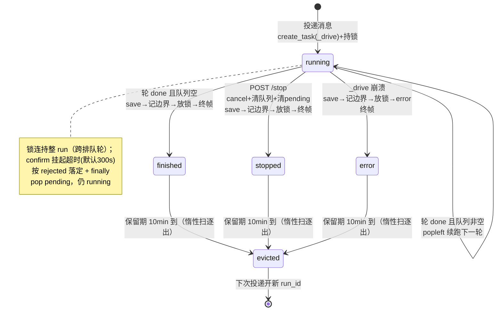
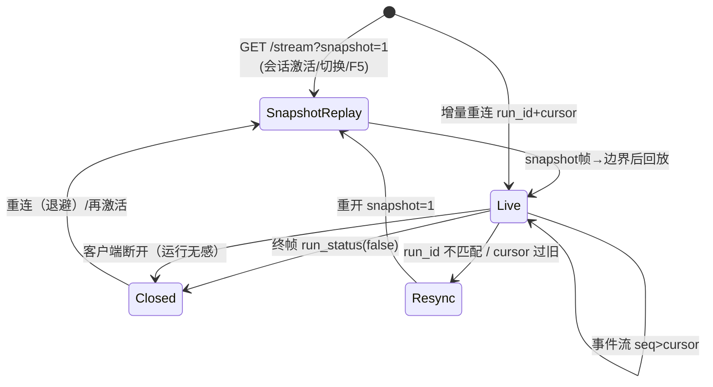
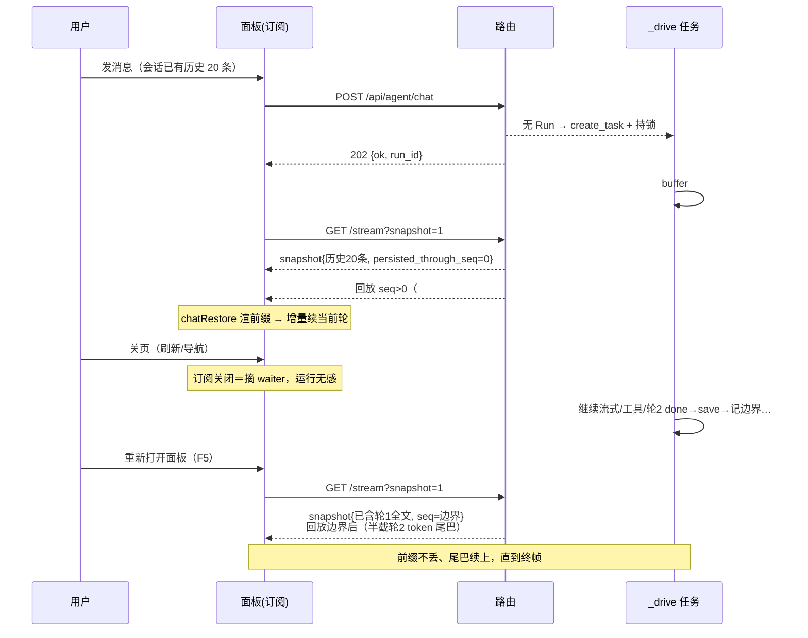
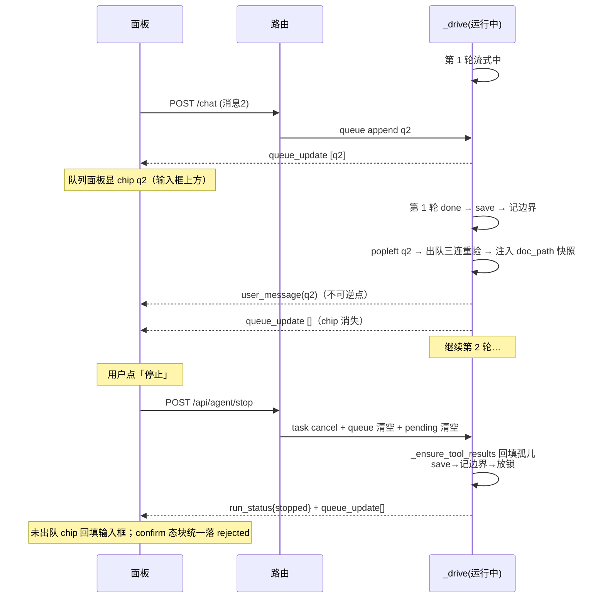

# Agent 运行脱离连接：关 SSE 续跑 / 重连回放 / 服务端消息队列

- 日期：2026-11-20（rev2，按 oracle 评审修订：B1 边界回放 / M1 run_id 游标契约 / M2 确认条目清理 / M3 删会话清 buffer / M4 总表勘正 + 10 条 minor 织入）
- 2026-11-20 rev3（用户实测修订）：出队即时前缀持久化（`persist_user`）+ 边界同步推进；snapshot 订阅对未终止 Run 合成 `run_status{true}`——修复「运行中会话在历史列表不可见，done 才出现」（§2 补记）。
- 待办：`aa6a2096`（agent chat 关闭 sse 链接续跑，重连 sse 可恢复；回答中发送消息进队列，done 事件后自动出队进 user message）
- 前作边界契约：`2026-11-19-agent-session-history.md`（「视图 ≠ 会话 ≠ 运行」——本期把「运行」真正独立出来，契约升级为 **视图 ≠ 会话 ≠ 运行 ≠ 连接**）

## 0. 目标与非目标

**目标**
1. LLM 运行与 HTTP 连接解耦：客户端关页/断网/切会话，运行在服务端继续。
2. 重连恢复 = **快照前缀 + 边界回放 + 实时尾巴**：订阅原子地送「已持久化消息快照 + 边界后事件回放 + live 尾巴」（决策：2026-11-20 问答轮 + 评审 B1 修法 a）。
3. 回答中发送的消息进**服务端队列**（跟会话走，刷新不丢），每轮 `done` 后自动出队开下一轮。
4. 「停止」升级为显式协议：停运行 + 清队列。

**非目标**
- 运行跨服务进程重启存活（纯内存，重启即弃，见 §9）。
- 队列消息编辑/改序/优先级。
- 列表级 SSE 推送（历史列表用 4s 轮询）。
- 多机/多进程部署（单 vault 单服务器前提不变）。

## 1. 现状（要拆的三根线）

- 运行绑死连接：`POST /api/agent/chat` 的 StreamingResponse 生成器内 `async for agent.chat()`（routes/agent.py:243-273）；断连 → 生成器被取消 → LLM 流/工具循环当场夭折。session 锁、轮末持久化、事件推送全部寄生在这个生成器。
- 前端发送=订阅一体：`doSend` 一个 fetch 同时投递与收流；`stopChat` 的 abort 就是「停止」的全部。
- 确认阻塞在内存：`pending_confirms` + `await entry.event.wait()`（runtime.py:393）无超时——运行脱离连接后无人应答即永久挂起。

## 2. 运行体 RunHub（新模块 `server/agent/runhub.py`）

- `RunHub` 持于 `register()` 闭包层（同 `agent_cache` 层），`runs: dict[sid, Run]`。**生命周期耦合面声明（评审 n1）**：agent_cache / session_mgr / RunHub 三套按 sid 的状态表从此必须同步演化——删除路径（DELETE 路由）触三处、TTL 驱逐触 agent_cache+RunHub、`SessionManager.remove` 触一处；**RunHub 拥有 run 生命周期裁决权**，其余两表只被通知。
- `Run = {run_id, task: asyncio.Task, buffer: list[(seq, event)], seq: int, persisted_through_seq: int, queue: list[QueuedMsg], waiters: set[asyncio.Queue], state}`。
- **生命周期**：投递消息 → 无活跃 Run 则 `create_task(_drive(sid))`；`_drive` 从队头逐条驱动 `agent.chat()`，事件 append buffer + 广播 waiters；`done` 后队列非空则 popleft 立即开下一轮，空则收摊。SSE 断开只减一个 waiter，不参与生命周期。
- **锁**：session 锁由 `_drive` **从 run 创建到终止连持不放**（跨排队轮次，评审 n5 写死措辞；替代 HTTP 生成器 acquire/release）。既有保护自动继承：TTL 驱逐跳过持锁会话（routes/agent.py:52）、删会话 busy 409（routes/agent.py:435）。
- **持久化与边界**：`session_mgr.save` 每轮结束执行（正常/error/stopped 三口径同一落库点）；**每次 save 成功后立刻记 `persisted_through_seq = 当前 buffer 尾 seq`**（§5 恢复协议的边界来源）。**退出顺序钉死（评审 m2）：save 先于终帧 `run_status{false}`**——客户端见终帧即可能重连走快照路径。`_drive` 外层 `except asyncio.CancelledError`（stop 路径）与 `except Exception`（崩溃路径）**必须分开写**（Py3.8+ CancelledError 是 BaseException，`except Exception` 吞不掉）。
  - **补记（2026-11-20 用户实测修订，rev3）**：save 点契约从「每队列项完成时全量」扩为「**出队即前缀 + 完成时全量**」——`_drive` 出队后（`user_message`/`queue_update` 广播之后、`agent.chat` 首帧之前）调 `persist_user(sid, text)`（路由注入：save = 当前会话消息**副本**追加 user 行，绝不改共享原 list），随后推进 `persisted_through_seq` 覆盖这三帧。效果：运行中会话即时进历史列表（列表滤空行，此前 done 前整轮不入库故不可见）；snapshot 前缀已含 user 行，边界后回放不得再吐 `user_message`（不重复气泡）。配套：`subscribe(snapshot=True)` 对未终止 Run（`finished_at is None`）在 snapshot 头后、回放前补发**合成** `run_status{running:true, seq=边界值}`（边界推进/修剪会把真实 busy 帧划进前缀或整帧丢弃——busy 需有驱动源；seq=边界值防游标回退；合成帧不入 buffer）。终止 Run 不合成（buffer 尾部必有真实终帧可回放）。
- **RunHub 逐出（评审 m3）**：终止态 Run 保留 `RUN_RETAIN=10min`（覆盖「刷新时恰好跑完」的回放窗口）。**惰性清理，零定时器**：任意 sid 的 POST /chat、GET /stream、POST /stop 入口顺带扫过期终止 Run 逐出。下次投递开**新 run_id、新 buffer、seq 归零**。
- **确认超时（评审 M2 重写）**：runtime.py:393 `wait()` 改 `asyncio.wait_for(..., timeout)`，默认 **300s**（`ai_config.confirm_timeout` 可配，config.example.yaml 同步——评审 n4）。三处硬约束：
  1. `entry["event"].wait()` 外必须 `finally: agent.pending_confirms.pop(tc_id, None)`——超时/cancel 两条新退出路径都不留僵尸条目（否则 routes/agent.py:59 的「pending_confirms 豁免」把该 Agent 钉死到进程重启，且迟到 `/confirm` 命中僵尸返回假 200）；
  2. 超时分支判 rejected 前先查 `entry["approved"] is not None`（确认与超时同帧落定的双裁决竞态，单 loop 可达，防双发 tool_result）；
  3. stop 路径清空该会话全部 `pending_confirms`。
  （n2：超时落地后 pending_confirms 驱逐豁免基本失去意义，保留但注释更新。）

## 3. 事件通道（环形缓冲 + 边界回放 + 订阅）

**缓冲**
- `buffer: list[(seq, event)]`，seq 从 1 单调递增，每事件一个；事件字典顶层加 `run_id`、`seq` 两键（SSE 载荷仍是平铺 `{type, ...}`，前端解析零重构）。
- token/reasoning 逐 token 原样入缓冲（一轮 4096 token ≈ 数百 KB/会话）；上限 `BUFFER_MAX_EVENTS=20000`，到顶裁最旧（裁后边界回放可能触发 resync，§9）。

**订阅端点** `GET /api/agent/stream?session_id=<sid>&run_id=<r>&cursor=<n>&snapshot=1`
- **`snapshot=1`（恢复/首订阅）**：服务端在同一事件循环步内原子读出「持久化消息快照 + 当前 `persisted_through_seq`」，依次发 `snapshot{messages, persisted_through_seq}` → 回放 `seq > persisted_through_seq` → live。**单源单读，杜绝「先拉 detail 再订阅」的 fetch 竞态双源重复/漏帧（评审 B1）**。无 Run 时快照直接读 DB 行 + `run_status{running:false, state:null}` 即关（统一恢复源，200 合法空态）。
- **增量重连（带 `run_id`+`cursor`，评审 M1）**：服务端校验 run_id——不匹配或缺参 → `resync{}`（客户端重开 snapshot=1 订阅）；匹配 → 回放 `seq > cursor` → live。游标只在同 run_id 内有效。
- cursor 早于缓冲现存最早 seq（被修剪）→ `resync{}`（降级=重开 snapshot=1）。
- 每连接一个 `asyncio.Queue` 进 waiters——多标签页天然同步。不设背压上限（LAN 单用户，缓冲有界）。
- 终帧 `run_status{running:false, state:…}` 后服务端关流。

**契约变化**：`done` 仍只表示**单轮**收尾；「整体运行结束」由 `run_status{running:false}` 表达。前端忙态一律由 run_status 驱动。

## 4. 队列（服务端，跟会话走）

- 每条投递带 `qid`（服务端分配，短 uuid）与**入队时刻的 doc_path 快照**：出队时注入自己那份文档上下文（排队期间切文档不影响已发消息的语境）。
- **出队重验（评审 m6，隐私红线义务）**：出队注入前对该 doc_path 快照重跑 `_safe_rel_path` + 存在性 + `_privacy_hit` 三连（排队期间文件删除/入隐私区 → 降级为无 doc_path / privacy_doc 文案，同现行入口语义）。
- 运行中 → append queue + 广播 `queue_update`；上限 `QUEUE_MAX=5`，超限 409「队列已满」。
- 出队 = `_drive` 单驱动循环内 popleft，事件在同一 buffer 连号；出队时发 `user_message{qid, text}`。**发布点=不可逆点（评审 m1）**：user_message 入 buffer 后 stop，该气泡照实存在（未回轮内容不回填，下轮 `_ensure_tool_results` 自愈），spec 于此备案。
- `POST /api/agent/queue/remove {session_id, qid}`：删除未出队项；已出队的 qid 静默 200。队列面板**只认 queue_update 事件**（单一真相源）。
- 停止时未出队项：前端 chip 消失、内容回填输入框（多条换行拼接）——消息没发出去，内容不蒸发（双标签页双回填见 §9）。

## 5. 渲染模型（事件驱动单一消息源）

- **user 气泡由 `user_message` 事件产生**（首条与排队条同路径），前端不再本地回显。
- **恢复管线（统一走 stream 订阅，评审 B1 修法 a）**：会话激活（挂载/切换/F5）一律 `GET /stream?...&snapshot=1`：
  1. `snapshot.messages` → 既有 chatRestore 管线渲染**历史前缀**（含此前所有轮次——replay-only 吞前缀的 blocker 由此闭合）；
  2. 边界后事件（含当前半截轮的 token 尾巴）→ 事件分发器**增量续上**；
  3. live 尾巴直到终帧。
  `GET /api/agent/sessions/{sid}` 保留原语义（恢复不再依赖它，减少双源歧义后仍为通用详情面）。
- 队列面板 = 输入框上方固定条（非滚动气泡流）：每条一行 = 文本截断 + `×` 删除钮（真 `<button>`，a11y 红线）；空队列隐藏；history 视图无此面板。
- **历史列表运行中徽标**：`GET /api/agent/sessions` 投影由 RunHub 现场注入 `running: bool`（仅活跃 Run；保留期内终止不算）。行右侧（× 位左侧）转圈 svg（`aria-hidden` + `title="运行中"`）。history 视图打开期间每 4s 静默重拉列表，关闭即停。当前会话行忙态同源改用 `running`。

## 6. 接口与事件总表

**HTTP**（agent 域路由 10 → 13，`test_routes_order` 快照 45→48 + docstring 同步；新增三条注册进 agent 域块 feedback 之后）

| 端点 | 变化 |
|---|---|
| `POST /api/agent/chat` | 改纯投递：`202 {ok, run_id}`（**无 queued 字段**，评审 m9——队列面板只认 queue_update，API 不留歧义）；队列满 409；doc_path 409 / AI 未配 503 前置保留 |
| `GET /api/agent/stream` | 新增订阅 SSE（`session_id` + 可选 `run_id`/`cursor`/`snapshot`） |
| `POST /api/agent/stop` | 新增：cancel task + 清队列 + 清该会话 pending_confirms → 终帧 `run_status{stopped}`；幂等 `{ok, stopped}` |
| `POST /api/agent/queue/remove` | 新增：`{session_id, qid}` → `{ok}`（不存在静默成功） |
| `GET /api/agent/sessions` | **响应体投影 + `running` 字段**（RunHub 现场注入，评审 M4 勘正——非零改动） |
| `DELETE /api/agent/sessions/{sid}` | 成功路径追加 `runhub.discard(sid)`（评审 M3：清保留期 buffer，否则删过的会话从回放整段复活）；busy 409 仍挡活跃 Run |
| confirm / settings / feedback / new-session / session 详情 | 零改动 |

**事件**（全部带 `run_id`+`seq`；新五类进 buffer 可回放，旧十类原样）

| 事件 | 载荷 | 时机 |
|---|---|---|
| `snapshot` | `{messages, persisted_through_seq}` | snapshot=1 首帧（不入 buffer，是订阅应答头） |
| `run_status` | `{running, state: running\|finished\|stopped\|error\|null}` | 首帧（snapshot 后）+ 终帧 |
| `user_message` | `{qid, text}` | 出队开轮时 |
| `queue_update` | `{queued: [{qid, text}]}` | 入队/出队/删除/清空后 |
| `resync` | `{}` | run_id 不匹配 / 游标过旧 |
| 旧十类 | round/token/reasoning/tool_call/confirm_request/tool_result/token_usage/error/done | 不变 |

**与既有功能边界**
- **上期「流式中切换会话 → 停止并切换？」确认框撤销**（`confirmSwitchId` 状态机拆除，连带上期静态钉改写）——那是无后台续跑时的过渡设计；切换=关旧订阅开新订阅，原运行后台继续，切回走 §5 恢复管线。停止钮保留真停止语义。
- 删会话 busy 409、TTL 跳过持锁/待确认会话：机制不变，持锁者换成运行体；TTL 驱逐同视 RunHub 活跃态（n1 的同步演化面）。
- token_usage 事件可回放 → 保留期内刷新用量条自愈；超期归零沿用现口径。
- **终帧 UI 收尾（评审 m4）**：分发器收到终帧后，对当前会话 `status==='confirm'` 的工具块统一落 `rejected`（迟到的 `/confirm` 404 亦在此口径下收口）。

**错误与断线**
- 轮内 error（error+done）→ 该轮收尾，**队列继续出队**（排队是预先的明确意图，一轮失败不吞后续）。
- `_drive` 崩溃 → 补 error + `run_status{error}`（**save 先于终帧**，§2 顺序钉）+ 放锁，buffer 保留。
- 面板订阅断线（非主动）→ 指数退避重连（1s 起封顶 30s），游标保留；resync 帧触发 snapshot=1 重订阅；面板卸载摘订阅。

## 7. 前端改造面（AIChatPanel 重构）

1. **常驻订阅**：会话激活开 `snapshot=1` 订阅，后续断线增量重连带 run_id+cursor；卸载/切会话摘订阅。忙态/按钮可用性/输入锁由 run_status 驱动。
2. **发送 = POST 投递**：`doSend` 拆 `submit()`（无 reader）；本地回显删除；`sendChain` 废除（服务端队列天然串行）。
3. **事件分发器拆 `utils/chatEvents.js`**（node 可直测，照 chatRestore 先例）：现有 switch + 新五分支 + run_id 校验。
4. **队列面板**、**历史徽标 + 4s 轮询**：见 §5。
5. **恢复管线**：§5 三步（chatRestore 复用为前缀渲染器）。
6. **停止钮**：`stopChat` 改 POST stop；本地只关订阅留游标（停止后回放可见 stopped 终帧）。
7. **历史列表**：spinner 徽标 + 4s 轮询 + **切换确认框拆除**（`confirmSwitchId` 状态机连同上期静态钉一并拆）。
8. **既有钉/行为翻转清单（评审 m8，plans 施工对照表）**：send 钮 `hidden: status==='thinking'`（AIChatPanel.js:869）→ 反转为运行中可发送进队列；切换路径 `stopChat`（:540）、`onUnmounted` abort（:644）、`watch(sessionId)` abort（:604）→ 全部换「摘订阅」；`test_session_history_view_pins` 的切换确认组删除。

## 8. 状态机与关键时序

### 8.1 Run 状态机

订阅者视角（每连接独立游标，互不影响）：

### 8.2 关链接续跑 + 刷新重连（核心场景，rev2 边界回放）

### 8.3 排队、出队、停止

## 9. 已知边界与限制（备案）

- **服务进程重启**：运行丢（同现状断连即夭折的失败面，不更差）；孤儿 tool_call 由 `_ensure_tool_results` 兜 API 合法性（其不变式「每次模型调用前必跑」覆盖流式中 cancel / confirm 等待中 cancel / 崩溃 / 重启后首调用四个新取消面）。
- **RunHub task 不进 `build_runtime()` 的 `Runtime.stop()` 家族**：服务关停时在跑运行被 loop 拆除掐掉，与上行同失败面，非遗漏。egress 审计 finally 全同步无 await 点（runtime.py:441-453），cancel 下照常收口。
- 确认挂起最长 300s 自动拒绝——离线期间 write/edit 大概率被拒后收尾；多工具排队时饥饿上界 300s×N，回来看到 rejected 需重发意图。
- buffer 修剪或 run_id 换代 → resync 重开 snapshot=1（前缀永不丢，半截轮自边界起可能缺开头 token 段——设计上有，20000 事件上限下罕触发）。
- 观感分叉备案（评审 m7）：cancel 窗口内 tool_result 已入 buffer 而 tool 消息未落历史 → 回放显 ✓、持久化后历史显「interrupted」合成结果。以持久化为准。
- 多标签页降级（评审 m5）：一标签走快照路径（无活跃 Run）时不持 live 订阅；另一标签随后开跑，本标签页只在切会话/刷新/4s 列表轮（history 视图）时感知，聊天视图内不自愈。接受。
- 双标签页停止回填（评审 m10）：两标签各回填一份未出队内容（后写者赢口径延伸），接受。
- 多标签页并发投递/停止：全部串行进单驱动，无竞态义务。
- **中断时的半截输出与 stop 意图信号（用户实测讨论 2026-11-20）**：run 死亡（stop/crash）后，在飞文本半截与全部思考链只活在 live 画面，重进即蒸发（工具事实与 change_ledger 不受影响）——live/持久化分叉同族（评审 m7 口径「以持久化为准」的延伸面）。完整思考与设计草案（通道一：半截文本持久化，**spec 已立** [`2026-11-20-partial-output-retention.md`](2026-11-20-partial-output-retention.md)；通道二：stop 信号账本 + 失败轮思考选段 + bgagent 消费闭环，未排期）见 [`../notes/2026-11-20-interruption-semantics-and-signals.md`](../notes/2026-11-20-interruption-semantics-and-signals.md)。

## 10. 测试与目检

**后端 pytest**（新 `tests/test_runhub.py` + agent 路由测试大改）
投递即 202 / 拉起运行+持锁 / 队列串行出队（含出队重验三连）/ 上限 409 / queue.remove（含已出队竞态）/ stop 三口径（轮中停、pending 清空、孤儿回填、**save 先于终帧**顺序钉）/ snapshot 帧前缀完整性（历史会话中途刷新不吞前缀——B1 回归钉）/ 边界回放精确（只发 seq>persisted_through_seq）/ 修剪 resync / run_id 不匹配 resync / **断连不影响运行**（订阅关闭后任务继续、全量可回放）/ 确认超时自动拒绝（finally pop + 同帧双裁决）/ busy 删会话 409 / **保留期删会话后 stream 空态（M3 回归钉）** / TTL 跳过 / 终止保留期惰性逐出 / 无运行体 snapshot 空态。

**前端**：`chatEvents.js` node 行为测试（分发器纯函数：新五分支、run_id 校验、resync、终帧 confirm 块收尾）+ 静态钉（停止钮 POST stop、切换确认拆除、send 钮不再随 thinking 隐藏、队列面板结构、4s 轮询、spinner 徽标、`/api/agent/stream` 入 api.js 端点钉）。

**目检清单**（布局类改动经浏览器目检批准方可 commit——AGENTS 规则 3）
1. 跑长任务 → 关面板/刷新 → **历史前缀全在** + 半截轮回放续上实时尾巴（B1 目检钉）
2. 回答中连发 3 条 → 队列面板三条 → 逐条出队转正进气泡流
3. 队列单条删除即时生效
4. 停止 → 运行停 + 未出队内容回填输入框 + confirm 态块收尾
5. 后台跑的会话在历史列表转圈，跑完停转（≤4s）
6. 切走切回不打断任何运行（无确认框）
7. 确认超时自动拒绝（临时调短 timeout 验）
8. 多标签页双开同会话，两边同步
