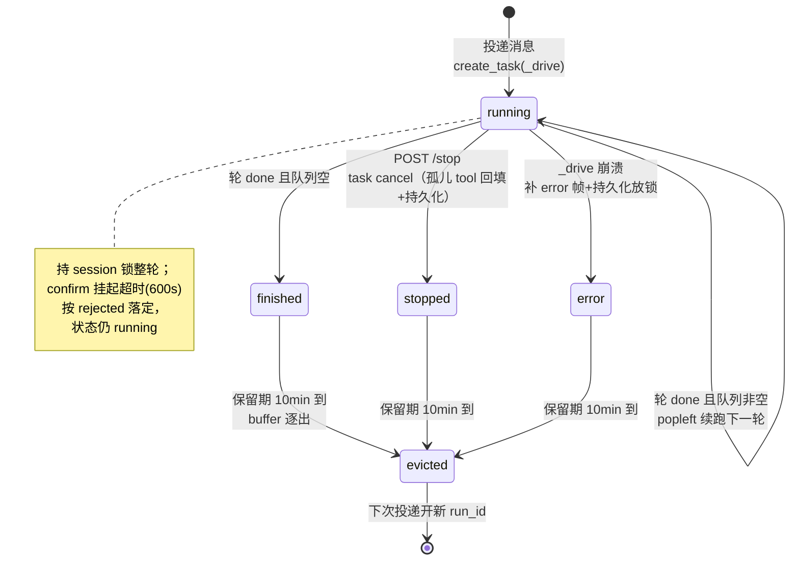
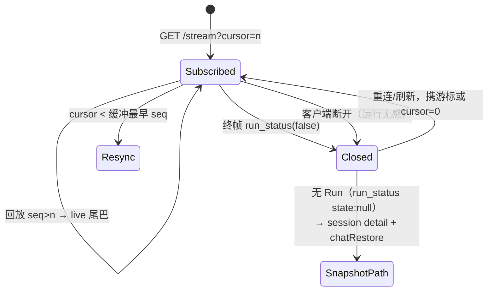
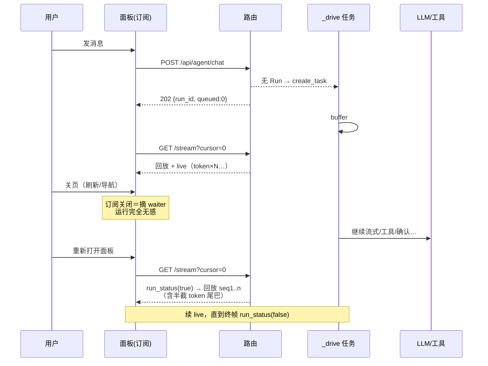
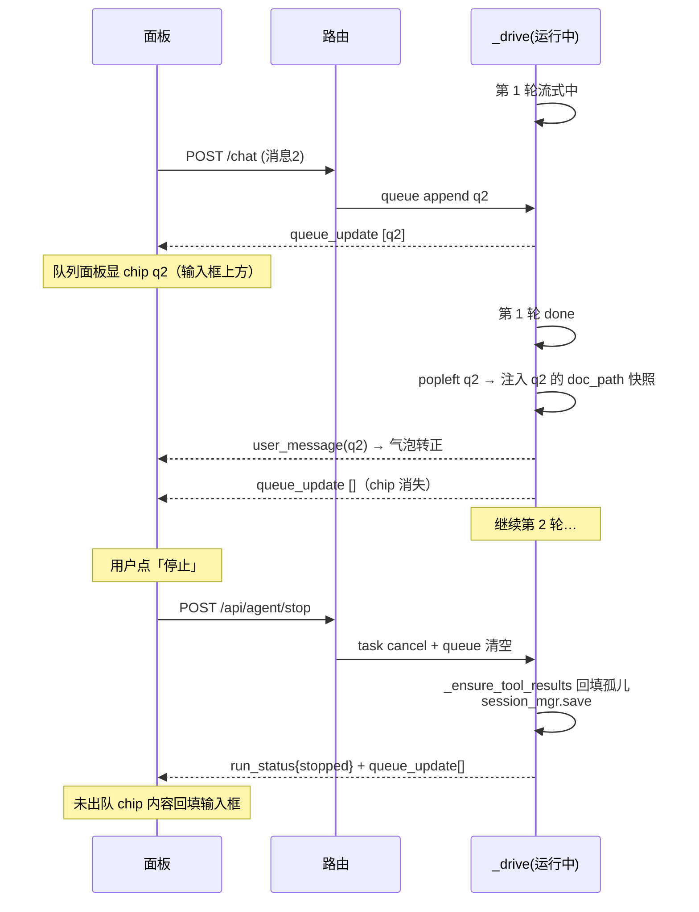

# Agent 运行脱离连接：关 SSE 续跑 / 重连回放 / 服务端消息队列

- 日期：2026-11-20
- 待办：`aa6a2096`（agent chat 关闭 sse 链接续跑，重连 sse 可恢复；回答中发送消息进队列，done 事件后自动出队进 user message）
- 前作边界契约：`2026-11-19-agent-session-history.md` §4（「视图 ≠ 会话 ≠ 运行」——本期把「运行」真正独立出来，契约升级为 **视图 ≠ 会话 ≠ 运行 ≠ 连接**）

## 0. 目标与非目标

**目标**
1. LLM 运行与 HTTP 连接解耦：客户端关页/断网/切会话，运行在服务端继续。
2. 重连恢复 = **事件回放 + 实时尾巴**：带游标重订阅，补发已错过的事件并续上 live 流（决策：2026-11-20 问答轮）。
3. 回答中发送的消息进**服务端队列**（跟会话走，刷新不丢），每轮 `done` 后自动出队开下一轮。
4. 「停止」升级为显式协议：停运行 + 清队列。

**非目标**
- 运行跨服务进程重启存活（纯内存，重启即弃，见 §9）。
- 队列消息编辑/改序/优先级。
- 列表级 SSE 推送（历史列表用 4s 轮询）。
- 多机/多进程部署（单 vault 单服务器前提不变）。

## 1. 现状（要拆的三根线）

- 运行绑死连接：`POST /api/agent/chat` 的 StreamingResponse 生成器内 `async for agent.chat()`（routes/agent.py:243-273）；断连 → 生成器被取消 → LLM 流/工具循环当场夭折。session 锁、轮末持久化、事件推送全部寄生在这个生成器。
- 前端发送=订阅一体：`doSend` 一个 fetch 同时投递与收流；`stopChat` 的 abort 就是「停止」的全部。
- 确认阻塞在内存：`pending_confirms` + `await entry.event.wait()`（runtime.py:393）无超时——运行脱离连接后无人应答即永久挂起。

## 2. 运行体 RunHub（新模块 `server/agent/runhub.py`）

- `RunHub` 持于 `register()` 闭包层（同 `agent_cache` 层），`runs: dict[sid, Run]`。
- `Run = {run_id, task: asyncio.Task, buffer: list[(seq, event)], seq: int, queue: list[QueuedMsg], waiters: set[asyncio.Queue], state}`。
- **生命周期**：投递消息 → 无活跃 Run 则 `create_task(_drive(sid))`；`_drive` 从队头逐条驱动 `agent.chat()`，事件 append buffer + 广播 waiters；`done` 后队列非空则 popleft 立即开下一轮，空则收摊。SSE 断开只减一个 waiter，不参与生命周期。
- **锁与持久化随迁**：session 锁由 `_drive` 整轮持有（替代 HTTP 生成器 acquire/release）；`session_mgr.save` 每轮结束执行（正常/error/stopped 三口径同一落库点）。既有保护自动继承：TTL 驱逐跳过持锁会话（routes/agent.py:52）、删会话 busy 409（routes/agent.py:435）。
- **RunHub 自身逐出**：终止态 Run 保留 `RUN_RETAIN=10min`（覆盖「刷新时恰好跑完」的回放窗口）后逐出。下次投递开**新 run_id、新 buffer、seq 归零**。
- **确认超时**：runtime.py:393 `wait()` 改 `asyncio.wait_for(..., timeout)`，默认 600s（`ai_config.confirm_timeout` 可配）；超时按 `approved=False` 落定，发 `tool_result(rejected)`，运行干净收尾（决策：超时自动拒绝）。

## 3. 事件通道（环形缓冲 + 游标回放 + 订阅）

**缓冲**
- `buffer: list[(seq, event)]`，seq 从 1 单调递增，每事件一个；事件字典顶层加 `run_id`、`seq` 两键（SSE 载荷仍是平铺 `{type, ...}` 形态，前端解析零重构）。
- token/reasoning 逐 token 原样入缓冲（一轮 4096 token ≈ 数百 KB/会话，可接受）；上限 `BUFFER_MAX_EVENTS=20000`，到顶裁最旧。

**订阅端点** `GET /api/agent/stream?session_id=<sid>&cursor=<n>`（SSE）
- 无 Run → 一帧 `run_status{running:false, state:null}` 即关（200，合法空态）。
- 有 → 回放 `seq > cursor` 全部 → 挂实时尾巴 → 终帧 `run_status{running:false, state:…}` 后关流。
- cursor 早于缓冲现存最早 seq（被修剪）→ 发 `resync{}`：客户端放弃精确回放，改拉 session detail 快照重建 + 从缓冲现存头续 live。
- 每连接一个 `asyncio.Queue` 进 waiters——多标签页天然同步。不设背压上限（LAN 单用户，缓冲有界）。

**契约变化**：`done` 仍只表示**单轮**收尾；「整体运行结束」由 `run_status{running:false}` 表达（done 后可能立即续跑排队消息）。前端忙态一律由 run_status 驱动。

## 4. 队列（服务端，跟会话走）

- 每条投递带 `qid`（服务端分配，短 uuid）与**入队时刻的 doc_path 快照**：出队时注入自己那份文档上下文（排队期间切文档不影响已发消息的语境）。
- 运行中 → append queue + 广播 `queue_update`；上限 `QUEUE_MAX=5`，超限 409「队列已满」。
- 出队 = `_drive` 单驱动循环内 popleft，事件在同一 buffer 连号；出队时发 `user_message{qid, text}`。
- `POST /api/agent/queue/remove {session_id, qid}`：删除未出队项；已出队的 qid 静默 200。队列面板**只认 queue_update 事件**（单一真相源）。
- 停止时未出队项：前端 chip 消失、内容回填输入框（多条换行拼接）——消息没发出去，内容不蒸发。

## 5. 渲染模型（事件驱动单一消息源）

- **user 气泡由 `user_message` 事件产生**（首条与排队条同路径），前端不再本地回显。
- **刷新/切换恢复二选一**，由订阅首帧裁决：
  - 有活跃 Run 或终止态保留期内 → **只信回放**（buffer 含本轮全部事件，不拉 session detail，杜绝双源重复）；
  - 无 Run → 走既有 session detail + chatRestore 管线（2026-11-19 §2.3 原样）。
- 队列面板 = 输入框上方固定条（非滚动气泡流）：每条一行 = 文本截断 + `×` 删除钮（真 `<button>`，a11y 红线）；空队列隐藏；history 视图无此面板。
- **历史列表运行中徽标**：`GET /api/agent/sessions` 投影由 RunHub 现场注入 `running: bool`（仅活跃 Run；保留期内终止不算）。行右侧（× 位左侧）转圈 svg（`aria-hidden` + `title="运行中"`）。history 视图打开期间每 4s 静默重拉列表，关闭即停。当前会话行忙态同源改用 `running`。

## 6. 接口与事件总表

**HTTP**（agent 域路由 10 → 13，`test_routes_order` 快照同步）

| 端点 | 变化 |
|---|---|
| `POST /api/agent/chat` | 改纯投递：`202 {ok, queued, run_id}`；队列满 409；doc_path 409 / AI 未配 503 前置保留 |
| `GET /api/agent/stream` | 新增订阅 SSE（`session_id` + `cursor` 默认 0） |
| `POST /api/agent/stop` | 新增：cancel task + 清队列 → 终帧 `run_status{stopped}`；幂等 `{ok, stopped}` |
| `POST /api/agent/queue/remove` | 新增：`{session_id, qid}` → `{ok}`（不存在静默成功） |
| confirm / settings / feedback / new-session / sessions 三路由 | 零改动 |

**事件**（全部带 `run_id`+`seq`；新四类进 buffer 可回放，旧十类原样）

| 事件 | 载荷 | 时机 |
|---|---|---|
| `run_status` | `{running, state: running\|finished\|stopped\|error\|null}` | 首帧 + 终帧 |
| `user_message` | `{qid, text}` | 出队开轮时 |
| `queue_update` | `{queued: [{qid, text}]}` | 入队/出队/删除/清空后 |
| `resync` | `{}` | 游标过旧 |
| 旧十类 | round/token/reasoning/tool_call/confirm_request/tool_result/token_usage/error/done | 不变 |

**与既有功能边界**
- **上期「流式中切换会话 → 停止并切换？」确认框撤销**（`confirmSwitchId` 状态机拆除，连带上期静态钉改写）——那是无后台续跑时的过渡设计；切换=关旧订阅开新订阅，原运行后台继续，切回游标接上。停止钮保留真停止语义。
- 删 busy 会话 409、TTL 跳过持锁/待确认会话：机制不变，持锁者换成运行体。
- token_usage 事件可回放 → 保留期内刷新用量条自愈；超期归零沿用现口径。

**错误与断线**
- 轮内 error（error+done）→ 该轮收尾，**队列继续出队**（排队是预先的明确意图，一轮失败不吞后续）。
- `_drive` 崩溃 → 补发 error + `run_status{error}` + 持久化放锁，buffer 保留。
- 面板订阅断线（非主动）→ 指数退避重连（1s 起封顶 30s），游标保留；resync 帧触发快照兜底；面板卸载摘订阅。

## 7. 前端改造面（AIChatPanel 重构）

1. **常驻订阅**：会话激活（挂载/sessionId 切换）开订阅（带游标），卸载/切换摘掉；忙态/按钮可用性/输入锁由 run_status 驱动。
2. **发送 = POST 投递**：`doSend` 拆 `submit()`（无 reader）；本地回显删除；`sendChain` 废除（服务端队列天然串行）。
3. **事件分发器拆 `utils/chatEvents.js`**（node 可直测，照 chatRestore 先例）：现有 switch + 新四分支 + `run_id` 校验（异 run_id 丢帧重置游标）。
4. **队列面板**、**历史徽标 + 4s 轮询**：见 §5。
5. **恢复二选一**：见 §5；F5 恢复与手动切换同管线不变。
6. **停止钮**：`stopChat` 改 POST stop；本地只关订阅留游标（停止后回放可见 stopped 终帧）。

## 8. 状态机与关键时序

### 8.1 Run 状态机

订阅者视角（每连接独立游标，互不影响）：

### 8.2 关链接续跑 + 刷新重连（核心场景）

### 8.3 排队、出队、停止

## 9. 已知边界与限制（备案）

- **服务进程重启**：运行丢（同现状断连即夭折的失败面，不更差）；孤儿 tool_call 由 `_ensure_tool_results` 兜 API 合法性。
- 确认挂起最长 600s 自动拒绝——离线期间 write/edit 类工具大概率被拒后收尾，回来看到 rejected 需重发意图。
- buffer 修剪后 resync 降级为「快照 + 未来 live」，半截当前轮不精确回放（设计上有，20000 事件上限下罕触发）。
- 多标签页对同一会话并发订阅/投递/停止：全部串行进单驱动，无竞态设计义务；「后写者赢」沿用 2026-11-19 §2.5 口径。

## 10. 测试与目检

**后端 pytest**（新 `tests/test_runhub.py` + agent 路由测试大改）
投递即 202 / 拉起运行 / 队列串行出队 / 上限 409 / queue.remove（含已出队竞态）/ stop 三口径（轮中停、孤儿回填、持久化）/ 游标回放精确序列 / 修剪 resync / **断连不影响运行**（订阅关闭后任务继续、全量可回放）/ 确认超时自动拒绝 / busy 删会话 409 / TTL 跳过 / run_id 换代游标语义 / 终止保留期逐出 / 无运行体首帧空态。

**前端**：`chatEvents.js` node 行为测试（分发器纯函数：新四分支、run_id 校验、resync）+ 静态钉（停止钮 POST stop、切换确认拆除、队列面板结构、4s 轮询、spinner 徽标、`/api/agent/stream` 端点入 api.js 钉）。

**目检清单**（布局类改动经浏览器目检批准方可 commit——AGENTS 规则 3）
1. 跑长任务 → 关面板/刷新 → 再开回放续上实时尾巴
2. 回答中连发 3 条 → 队列面板三条 → 逐条出队转正进气泡流
3. 队列单条删除即时生效
4. 停止 → 运行停 + 未出队内容回填输入框
5. 后台跑的会话在历史列表转圈，跑完停转（≤4s）
6. 切走切回不打断任何运行（无确认框）
7. 确认超时自动拒绝（临时调短 timeout 验）
8. 多标签页双开同会话，两边同步
