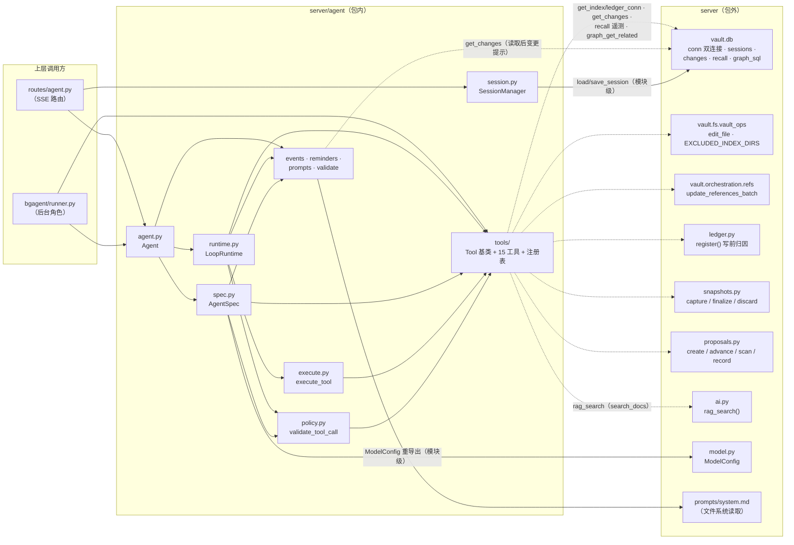

# server/agent/ — LLM Agent 系统

本模块遵循**声明与执行分离**：`AgentSpec` 描述一个通道**是什么**（模型 / 15 个工具 / prompt / 提醒 / 限额），`Runtime` 决定**怎么执行**——当前唯一实现 `LoopRuntime`（流式 LLM + 工具循环）是传输无关的，只 yield 类型化 `Event`：路由层把它序列化为 SSE（桌面渠道），bgagent runner 直接消费同一条事件流（后台角色）。渠道差异全部收敛在 spec 字段（`auto_approve` / `write_source` / `run_id` / `verbs` / `write_scope` / `report_dir`）；权限检查由 `spec.policy()` 派生 `ChannelPolicy`、`validate_tool_call` 单入口（见「权限三层」）。`Agent` 持有对话状态（messages / pending confirms / read tracking），`SessionManager` 负责持久化与 TTL 淘汰。入口在 `routes/agent.py` 的 `register()`：`POST /api/agent/chat`（SSE）经 `SessionManager.get_or_create` 恢复会话后驱动 `Agent.chat` → `LoopRuntime`；`permission="ask"` 的写操作另经 `POST /api/agent/confirm` 批准；`POST /api/agent/new-session` 新建会话并返回 `session_id`。会话管理与权限策略的深度论证见 spec `~/md-vault/projects/md-repo/specs/2026-10-09-session-manager-design.md` 与 `~/md-vault/projects/md-repo/specs/2026-10-22-agent-permission-policy-design.md`。

## 模块结构

| 文件 | 职责 |
|------|------|
| `agent.py` | `Agent` — 对话状态机：messages、pending confirms、read-tracking；`chat()` / `confirm()` |
| `runtime.py` | `Runtime` 基类 + `LoopRuntime` — 流式 LLM 循环，最多 `max_rounds` 轮，yield `Event` |
| `session.py` | `SessionManager` — 会话持久化（DB）+ 每会话 `asyncio.Lock` + 30 分钟 TTL 淘汰 |
| `spec.py` | `AgentSpec` 声明式配置 dataclass；`policy()` 派生 `ChannelPolicy`（`ModelConfig` 定义在 `server/model.py`，此处重导出） |
| `prompts.py` | `SYSTEM_PROMPT`（从 `server/prompts/system.md` 加载）、时间块 `_build_time_block`、SSE 格式化 `sse()` |
| `events.py` | `Event(type, data)` — 运行时事件数据类（**注意：非 `server/events.py` 进程内事件总线**） |
| `execute.py` | `execute_tool(name, args, ctx)` — 工具执行门面，只解析注册表实例 |
| `policy.py` | `ChannelPolicy` 通道能力声明、`validate_tool_call()` 检查单入口（L1/L2/L3）、`VAULT_GATES`（`SuggestionsGate`） |
| `validate.py` | `parse_since()` 等时间解析辅助（旧 `validate_tool_call` 已移入 `policy.py`） |
| `reminders.py` | `SystemReminder` / `UserReminder` 基类 + `TimeSystemReminder` / `DocPathUserReminder` |
| `tools/` | 15 个工具（一模块一工具）+ `tool.py`（`Tool` 基类 / `DocTool`）+ `__init__.py`（注册表） |

`__init__.py` 是兼容层：重导出公共面（`from server.agent import X` 仍可用），新代码建议直接从子模块 import。

## 公共 API（函数级）

### Agent 与运行时

| 符号 | 签名 | 说明 |
|------|------|------|
| `Agent` | `Agent(spec, runtime=None, messages=None)` | 对话状态机；`runtime=None` → `LoopRuntime()`；未给 `messages` 时以 `system_prompt` + 各 `SystemReminder` 初始化 |
| `Agent.chat` | `async chat(message, **ctx) -> AsyncIterator[Event]` | 一个用户回合，yield 运行时事件；`ctx` 携带 `doc_path` 等 per-call 数据 |
| `Agent.confirm` | `confirm(tool_call_id, approved) -> bool` | 解决 pending confirmation；未知 id 返回 `False` |
| `LoopRuntime.run` | `async run(agent) -> AsyncIterator[Event]` | 流式循环（`Runtime` 基类契约） |
| `Event` | `Event(type: str, data: dict)` | 事件数据类；`LoopRuntime` 实际 emit `round / reasoning / token / token_usage / tool_call / confirm_request / tool_result / done` |

### 会话管理

| 符号 | 签名 | 说明 |
|------|------|------|
| `SessionManager` | `SessionManager(db_conn, vault_dir)` | 会话消息存储 + 每会话锁；`db_conn=None` 时纯内存（`save` no-op 告警） |
| `.get_or_create` | `get_or_create(session_id) -> list[dict]` | 内存命中或从 DB 恢复 |
| `.create_new` | `create_new() -> str` | 新建会话，返回 uuid4 |
| `.get_lock` | `get_lock(session_id) -> asyncio.Lock` | 每会话锁（不存在则建） |
| `.cleanup` | `cleanup() -> None` | 淘汰空闲 > 30 分钟的会话（持锁者不淘汰） |
| `.save` | `save(session_id, messages=None) -> None` | 持久化到 DB，并刷新 `last_active` |
| `.get` | `get(session_id) -> list[dict] \| None` | 内存消息，无则 None |

### 工具与权限

| 符号 | 签名 | 说明 |
|------|------|------|
| `AgentSpec.policy` | `policy() -> ChannelPolicy` | 从 spec 派生通道能力（`auto_approve` 刻意不在内——它是 runtime 流程输入，非检查项） |
| `ChannelPolicy` | `ChannelPolicy(vault_dir, write_scope=None, report_dir=None, gates=())` | frozen dataclass，`validate_tool_call` 的唯一输入 |
| `validate_tool_call` | `validate_tool_call(name, args, policy) -> str \| None` | L1 schema → L2 语义边界 → L3 gates；返回错误串或 None |
| `VAULT_GATES` | `tuple[WriteGate, ...] = (SuggestionsGate(),)` | vault 不变量 gate，任何通道不可关 |
| `execute_tool` | `execute_tool(name, args, ctx) -> str` | 工具执行门面（未知工具 → 错误串） |
| `TOOL_REGISTRY` | `dict[str, Tool]` | 15 个工具，按注册序（= 发给 LLM 的顺序） |
| `TOOL_ARGS` | `dict[str, type[BaseModel]]` | 每工具的 pydantic 参数模型 |
| `TOOLS` | `list[dict]` | OpenAI 工具格式 |
| `Tool` / `DocTool` | — | `Tool` 模板方法基类（`validate` → `_execute`）；`DocTool` 提供文件不存在 / 移动 / 删除提示 |

### 工具清单（15 个，注册序）

ask 6 个（写/决策）：`write_doc` / `delete_doc` / `move_docs` / `edit_doc` / `adopt_proposal` / `reject_proposal`；其余 9 个 allow（读）。

| 工具 | 权限 | 说明 |
|------|------|------|
| `read_doc` | allow | 读取文档，offset/limit 分页，按 `read_doc_max_chars` 尾部截断；`on_success` 记 read-tracking |
| `search_docs` | allow | FTS5 + jieba 搜索（调 `server.ai.rag_search`），XML 结果；四档召回 + 自动升级链；recall 遥测入账 |
| `list_files` | allow | 列出 vault 文件 |
| `write_doc` | **ask** | 创建/覆盖文件；可逆层 pre-image + `ledger.register` 归因 |
| `delete_doc` | **ask** | 删除文件；precheck 存在性 |
| `move_docs` | **ask** | 批量移动/重命名；pre-rename 更新引用 |
| `edit_doc` | **ask** | 精确文本替换（`vault.fs.vault_ops.edit_file`） |
| `get_related_docs` | allow | 知识图谱关联（`graph_get_related`） |
| `recent_changes` | allow | 变更日志查询（since/source/limit） |
| `recall_stats` | allow | 召回遥测统计（带时间衰减） |
| `propose` | allow | 提案通道唯一写入口（DB 记录，零文件落）；`run_id`/`verbs` 为 trusted 戳 |
| `list_proposals` | allow | 列提案记录 |
| `get_proposal` | allow | 读单条提案 |
| `adopt_proposal` | **ask** | 采纳（人的决策，confirm 后 `proposals.advance`） |
| `reject_proposal` | **ask** | 拒绝（人的决策，confirm 后 `proposals.advance`） |

## 关键设计

### 对话链路

```
POST /api/agent/chat
  → SessionManager.cleanup() + get_or_create(session_id) + get_lock(session_id).acquire()
  → Agent.chat(message, doc_path=...)           # user reminders 先注入（strip 旧 + append 新）
      → LoopRuntime.run(agent)                  # 最多 max_rounds 轮
          每轮: Event(round) → 流式 model 调用 →
               Event(reasoning)* → Event(token)* → Event(token_usage)
               → 无 tool_calls: 记 assistant → Event(done, final) 终止
               → 有 tool_calls: 逐个派发（见下）
      permission="ask" 且非 auto_approve → Event(confirm_request) → 阻塞等用户
      → POST /api/agent/confirm → Agent.confirm(id, approved) → resolve
  → finally: SessionManager.save(session_id, agent.messages)  # 任何退出路径都落库 → release
```

`Event` 由路由层用 `sse(event.type, event.data)` 格式化为 SSE 行；`confirm_request` 是唯一的"挂起"事件，其余都直出。

### 工具派发链（每轮对每个 tool_call）

```
validate_tool_call(name, args, spec.policy())   # L1 schema / L2 语义边界 / L3 gates，首个非 None 拒绝
  → tool.precheck(args, ctx)                    # 工具声明的前置检查（如写前存在性），短路错误
  → permission=="ask" 且非 auto_approve：Event(confirm_request) → await 用户批准（拒绝 → 错误 tool_result）
  → execute_tool(name, args, ctx)               # → Tool.call() = validate(pydantic) + _execute
  → tool.on_success(args, result, ctx)          # 成功钩子（如 read-tracking）；result 以 "Error" 开头则跳过
```

`Tool.call()` 本身是两步模板（`validate` → `_execute`）；precheck / confirm / on_success 是 `LoopRuntime` 的编排，不在 `call()` 内。`validate()` 的错误回放收到的原值并附类型提示（`limit="50 lines"` → "pass an integer, e.g. 50"），帮模型下一轮自我纠正。

### 权限三层（`validate_tool_call` 单入口）

- **L1 pydantic schema**：`{loc}: {msg}` 简单格式（详单回放 + 类型提示在 `Tool.validate`，不重复）。
- **L2 语义边界**（权威边界）：resolve + vault 内 + 首段非 `.sync` + `write_scope`（仅 ask 工具）+ `report_dir` 禁写。语法层 `_check_md_path`（args-model 校验器）仅做早期失败，**不再是唯一防线**。
- **L3 gates**：`VAULT_GATES`（vault 不变量，无条件应用、通道不可关）+ `policy.gates`（通道专属，如 MCP 主区只读），按序检查，首个非 None 拒绝。`SuggestionsGate` 拒绝任何 ask 工具对 `suggestions/` 子树的写/移动/删除——提案只能经 `propose` 工具建记录，状态迁移走 `proposals.advance`。

### 写操作归因 + 可逆层

写工具（write/edit/move/delete）在**写盘前**调 `ledger.register(path, ctx.write_source, batch_id=ctx.run_id)`，确保 SnapshotWatcher 把变更归因到通道（agent 渠道 / bgagent alias）而非兜底的 `"watchdog"`。覆写/删除先 `snapshots.capture()` 捕获全文 pre-image，写后 `finalize()`；失败路径 `discard()` 不留残（写者只 `register`，记账由 watcher consumer 经 `ledger.consume` 落恰好一行）。详见 `server/README.md` 写者侧纪律。

### 双账本 DB 访问

工具不持有 DB 连接——经 `server.vault.db.conn.get_index_conn()`（index 侧：读变更日志 / 图谱 + recall 遥测写——`search_docs` 经此连接调 `recall.log_query()` 向 `recall_log` 落遥测行）与 `get_ledger_conn()`（写：提案记录 / 快照）懒加载，两连接同生命周期（见 `server/vault/db/README.md`）。锁只由 `vault.db` 具名持锁 mutation 函数在函数内部持有，agent tools 调具名函数、不持锁、不裸 SQL。

### 会话持久化与 TTL

消息持久化在 `sessions` 表（`vault.db.sessions`）。`SessionManager` 内存命中或从 DB 恢复；30 分钟空闲淘汰，但**持锁会话不淘汰**（避免运行中丢状态）；路由层在任何退出路径（正常 / 中断 / 异常）都 `save()`。

## 依赖方向



- **子图边界 = 包内 / 包外**；**实线 = 模块级依赖，虚线 = 方法内 lazy import**（执行时才解析——工具模块自包含、无 import 环）。跨包依赖以 lazy 为主，模块级仅三处：`session → vault.db.sessions`、`spec → model.ModelConfig`（重导出）、`tools/list_files → vault.fs.vault_ops.EXCLUDED_INDEX_DIRS`。`prompts.py → prompts/system.md` 是文件读取、非模块 import（图中实线）。
- 双连接 `get_index_conn()` / `get_ledger_conn()` 由工具经 `vault.db.conn` 懒加载（index 侧读变更日志/图谱 + recall 遥测写；ledger 侧写提案/快照）。
- 三方依赖仅 `openai`（`AsyncOpenAI`，runtime）与 `pydantic`（工具参数模型 / policy）。
- 本模块**不** import `server/events.py`（进程内事件总线）——本模块的 `events.py` 是运行时 `Event` 数据类，二者不同物。

## 注意事项

- **`events.py` 易混淆**：本模块的 `Event` 是运行时事件数据类；`server/events.py` 是 bgagent 调度用的进程内事件总线。import 路径不同，勿混。
- **`auto_approve` 不是权限**：它在 `LoopRuntime` 决定是否发 `confirm_request`（跳过确认提示），不进 `ChannelPolicy`。bgagent 恒 `auto_approve=True`；桌面渠道默认 `False`。
- **ask 工具的 L2 边界才生效**：`write_scope` / `report_dir` 只约束 `permission=="ask"` 的写工具；读工具不受限（agent 可查阅报告与更宽 vault）。
- **`propose` 是 allow 但非落盘**：提案通道零文件落（DB 记录 + `proposal_transitions` 是唯一状态源），`propose` 不经 `confirm`（它不是对现有文件的写），其状态迁移（adopt/reject）才走 ask 工具。
- **session 保存无鉴权隔离**：`SessionManager` 按 `session_id` 索引，LAN-only 设计（无鉴权，见 AGENTS.md）。

## 使用示例

```python
# 驱动一次对话（路由层是真实消费者；此处展示库级接口）
import asyncio
from pathlib import Path

from server.agent import Agent, AgentSpec, ModelConfig, SYSTEM_PROMPT
from server.agent.tools import TOOL_REGISTRY  # 注册表不在包 __init__ 重导出面

vault_dir = Path("vault")
model = ModelConfig(model_id="deepseek-chat",
                    base_url="https://api.deepseek.com/v1", api_key="...")
spec = AgentSpec(system_prompt=SYSTEM_PROMPT, model=model,
                 tools=list(TOOL_REGISTRY.values()), vault_dir=vault_dir,
                 read_doc_max_chars=4000)
agent = Agent(spec)  # 未给 messages → 以 system_prompt + system_reminders 初始化

async def drive():
    async for ev in agent.chat("整理一下 notes/"):
        if ev.type == "round":
            print(f"── round {ev.data['n']}")
        elif ev.type == "reasoning":
            print(ev.data["text"], end="")        # 思考流（provider 私有字段）
        elif ev.type == "token":
            print(ev.data["text"], end="")
        elif ev.type == "token_usage":
            print(f"\n[上下文 {ev.data['percent']}%]")
        elif ev.type == "tool_call":
            print(f"\n[调用] {ev.data['name']} {ev.data['args']}")
        elif ev.type == "confirm_request":        # 写操作等用户批准
            print("需要批准:", ev.data["name"], ev.data["args"])
            agent.confirm(ev.data["id"], approved=True)   # 生产走 POST /api/agent/confirm
        elif ev.type == "tool_result":
            print(f"[结果] {ev.data['result'][:80]}")
        elif ev.type == "done":                   # reason: final / round_limit
            break

asyncio.run(drive())
```
